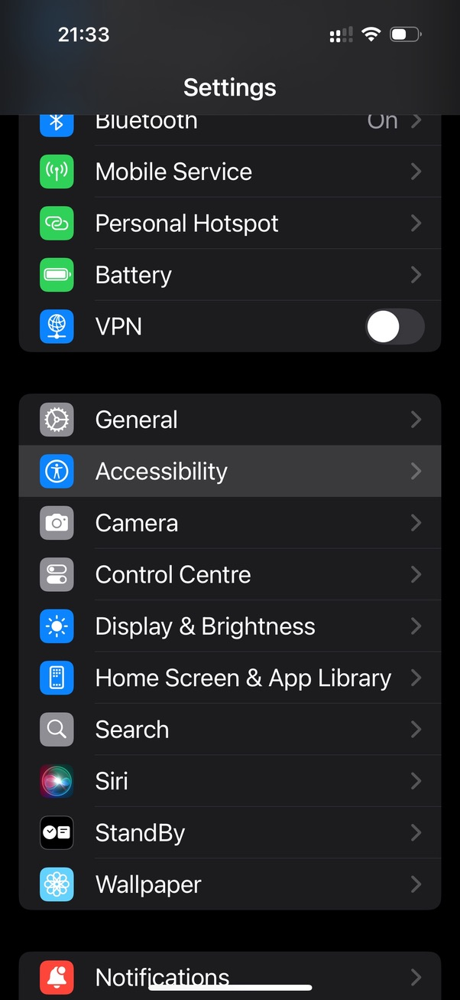
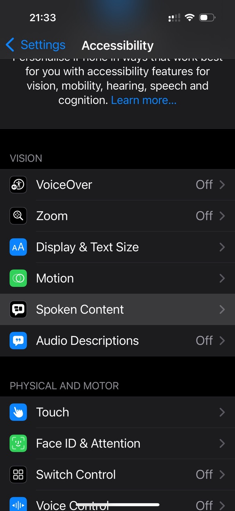
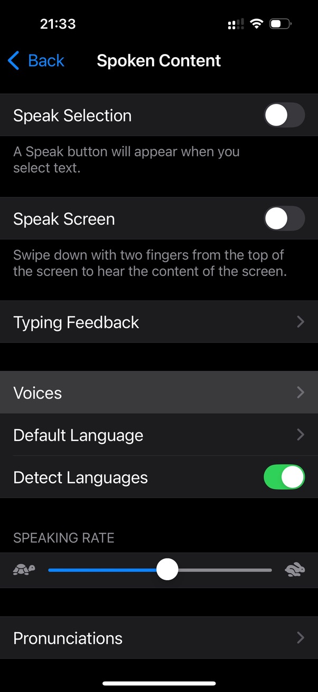

# How to download text-to-speech voices on iPhone

Want Semnal to speak in a different voice? iOS lets you download more text-to-speech (TTS) voices. Follow these simple steps:

## 1. Go to the Settings app

Open **Settings** on your iPhone.

## 2. Tap Accessibility

{: width="300" height="651"}

## 3. Select Spoken Content

{: width="300" height="651"}

## 4. Choose Voices

{: width="300" height="651"}

## 5. Download the voices you like

Pick a language, then download the voices you like.

> **Tip:** Downloaded voices can be used in Semnal. Choose a voice that suits you for the words your signal speaks.
